

  

## What I cook?
<h3 align="center">
  I cook <kbd>&nbsp;DevOps&nbsp;</kbd> and <kbd>&nbsp;Cloud&nbsp;</kbd> ☁️
</h3>

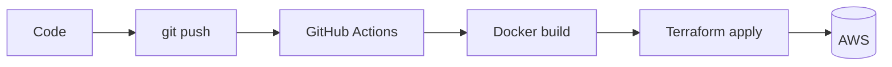

## Skills

  <a href="https://aws.amazon.com/"></a>
  <a href="https://www.docker.com/"></a>
  <a href="https://developer.hashicorp.com/terraform"></a>
  <a href="https://www.kernel.org/"></a>
  <a href="https://github.com/features/actions"></a>

## My AWS Skills

  <a href="https://aws.amazon.com/products/">
    
  </a>

## Open to see more

<table>
<tr><td align="center"><a href="https://aws.amazon.com/ec2/"></a></td><td align="center"><a href="https://aws.amazon.com/lambda/"></a></td><td align="center"><a href="https://aws.amazon.com/ecs/"></a></td><td align="center"><a href="https://aws.amazon.com/eks/"></a></td><td align="center"><a href="https://aws.amazon.com/fargate/"></a></td><td align="center"><a href="https://aws.amazon.com/s3/"></a></td><td align="center"><a href="https://aws.amazon.com/ebs/"></a></td></tr>
<tr><td align="center"><a href="https://aws.amazon.com/efs/"></a></td><td align="center"><a href="https://aws.amazon.com/rds/"></a></td><td align="center"><a href="https://aws.amazon.com/dynamodb/"></a></td><td align="center"><a href="https://aws.amazon.com/elasticache/"></a></td><td align="center"><a href="https://aws.amazon.com/vpc/"></a></td><td align="center"><a href="https://aws.amazon.com/route53/"></a></td><td align="center"><a href="https://aws.amazon.com/cloudfront/"></a></td></tr>
<tr><td align="center"><a href="https://aws.amazon.com/api-gateway/"></a></td><td align="center"><a href="https://aws.amazon.com/elasticloadbalancing/"></a></td><td align="center"><a href="https://aws.amazon.com/iam/"></a></td><td align="center"><a href="https://aws.amazon.com/kms/"></a></td><td align="center"><a href="https://aws.amazon.com/waf/"></a></td><td align="center"></td><td align="center"><a href="https://aws.amazon.com/cloudformation/"></a></td></tr>
<tr><td align="center"><a href="https://aws.amazon.com/cloudwatch/"></a></td><td align="center"><a href="https://aws.amazon.com/codepipeline/"></a></td><td align="center"><a href="https://aws.amazon.com/codebuild/"></a></td><td align="center"><a href="https://aws.amazon.com/systems-manager/"></a></td><td align="center"><a href="https://aws.amazon.com/sqs/"></a></td><td align="center"><a href="https://aws.amazon.com/sns/"></a></td><td align="center"><a href="https://aws.amazon.com/eventbridge/"></a></td></tr>
</table>

## Stats

  
  

## Contact

Contact for anything about AWS cloud: [deminhderozan@gmail.com](mailto:deminhderozan@gmail.com)

  

<pre align = "center">
  ⠀⠀⠀⠀⠀⠀⠀⠀⠀⠀⠀⠀⠀⠀⠀⠀⠀⠀⠀⠀⠀⠀⢀⡠⠔⠂⠉⠉⠉⠉⠉⠀⠒⠠⠄⡀⠀⠀⠀⠀⠀⠀⠀⠀⠀⠀⠀⠀⠀
⠀⠀⠀⠀⠀⠀⠀⠀⠀⠀⠀⠀⠀⠀⠀⠀⠀⠀⢀⡠⠔⠊⠁⠀⠀⠀⠀⠀⠀⠀⠀⠀⠀⠀⠀⠀⠉⠒⠤⡀⠀⠀⠀⠀⠀⠀⠀⠀⠀
⠀⠀⠀⠀⠀⠀⠀⠀⠀⠀⠀⠀⠀⠀⠀⠀⢠⠔⠁⠀⠀⠀⠀⠀⠀⠀⠀⠀⠀⠀⠀⠀⠀⠀⠀⠀⠀⠀⠀⠈⢆⠀⠀⠀⠀⠀⠀⠀⠀
⠀⠀⠀⠀⠀⠀⠀⠀⠀⠀⠀⠀⠀⠀⠀⢠⠃⠀⠀⠀⠀⠀⠀⠀⠀⣀⣀⠀⠤⠤⠒⣂⣈⣉⣁⣀⣄⠀⠀⠀⠀⠇⠀⠀⠀⠀⠀⠀⠀
⠀⠀⠀⠀⠀⠀⠀⠀⠀⠀⠀⠀⠀⠀⢠⠃⠀⠀⠀⢀⡠⠄⢒⣊⣉⣀⠤⠐⠒⠉⣁⡀⠤⠒⠒⠠⣄⠀⠀⠀⠀⢸⡀⠀⠀⠀⠀⠀⠀
⠀⠀⠀⠀⠀⠀⠀⠀⠀⠀⠀⠀⠀⢀⡇⠠⠔⣂⡭⢅⣒⡈⠁⠠⠤⠒⠒⠈⠉⠉⠀⠀⠀⠀⠀⠀⠀⠀⠀⠀⠀⢸⡁⠀⠀⠀⠀⠀⠀
⠀⠀⠀⠀⠀⠀⠀⠀⠀⠀⠀⠀⠀⢸⠁⠀⠀⠀⠋⠁⠀⠀⠀⠀⠀⠀⠀⠀⠀⠀⠖⠒⠂⠉⠉⠉⠉⠲⠀⠀⠀⠈⡇⠀⠀⠀⠀⠀⠀
⠀⠀⠀⠀⠀⠀⠀⠀⠀⠀⠀⠀⠀⢨⡇⠀⠀⠀⠀⠀⣀⣀⣀⡀⠀⠀⠀⠀⠀⠀⠀⡀⠀⠀⠀⠀⠀⠀⠀⠀⠀⠀⣇⠀⠀⠀⠀⠀⠀
⠀⠀⠀⠀⠀⠀⠀⠀⠀⠀⠀⠀⠀⠀⢇⠀⢀⡔⠊⠁⠀⠀⢀⣀⠱⠀⠀⢠⠀⣰⡯⢤⣶⣶⢲⠀⠀⠀⠀⠀⠀⠀⠻⠀⠀⠀⠀⠀⠀
⠀⠀⠀⠀⠀⠀⠀⠀⠀⠀⠀⠀⠀⠀⠸⡀⠀⠀⠀⡔⢲⣶⣶⠨⣭⡇⠀⢸⡄⠉⠃⠚⠛⠋⠉⠀⠀⠀⠀⠀⠀⠀⢸⠀⠀⠀⠀⠀⠀
⠀⠀⠀⠀⠀⠀⠀⠀⠀⠀⠀⠀⠀⠀⠀⣇⠀⠀⠀⠑⠚⠻⠛⠒⠁⣧⠀⠈⢇⠀⠀⠀⠀⠀⠀⠀⠀⠀⠀⠀⠀⠀⢸⡆⠀⠀⠀⠀⠀
⢀⣀⡀⠀⠀⠀⠀⠀⠀⠀⠀⠀⠀⠀⠀⢸⠀⠀⠀⠀⠀⠀⠀⠀⠀⢸⠀⠀⠘⡄⠀⠀⠀⠀⠀⠀⠀⠀⠀⠀⠀⠀⢸⠁⠀⠀⠀⠀⠀
⠘⠦⣉⠒⠒⠲⢄⡀⠀⠀⠀⠀⠀⠀⠀⠀⡇⠀⠀⠀⠀⠀⠀⠀⢠⠏⠀⠀⠀⠈⢣⠀⠀⠀⠀⠀⠀⠀⠀⠀⠀⠀⣞⠀⠀⠀⠀⠀⠀
⠀⠀⢸⠁⠀⠀⠀⠈⠉⠑⠂⠠⠤⣀⣀⡀⢹⡀⠀⠀⠀⠀⠀⠀⠙⣄⢀⡤⠤⠤⠟⠁⠀⠀⠀⠀⠀⠀⠀⠀⢠⢲⠟⡆⠀⠀⠀⠀⠀
⠀⢀⡞⠀⠀⠀⠀⠀⠀⠀⠀⠀⠀⠀⠀⠀⠈⢧⡆⡀⠀⠀⠀⠀⠀⡈⢠⣤⡀⠀⡄⠀⠀⠀⠀⠀⠀⠀⢀⡖⣮⡿⣧⡘⠄⣀⠀⠀⠀
⠀⠸⠦⠤⠢⢄⡀⠀⠀⠀⠀⠀⠀⠀⠀⠀⠀⠈⢳⡏⠀⠀⠀⢠⡞⢀⣾⣅⣁⣀⡁⠈⣦⡀⢠⡀⠀⢰⣟⣿⣿⢻⣃⠀⠀⠀⠈⠑⠲
⠀⠀⠀⠀⠀⠀⠈⠐⢄⠀⠀⠀⠀⠀⠀⠀⠀⠀⠀⠙⣦⡆⢠⣛⠀⣾⣿⣿⣿⣿⣿⣦⣀⠋⢸⣴⢴⡃⠿⣽⢯⠢⡽⠀⠀⠀⠀⠀⠀
⠀⠀⠀⠀⠀⠀⠀⠀⠀⠑⠢⡀⠀⠀⠀⠀⠀⠀⠀⠀⠜⢷⣯⡿⣎⢿⣿⣿⣿⣿⣿⢟⡇⠀⠀⡿⠘⢙⡼⡿⠖⠀⠀⠀⠀⠀⠀⠀⠀
⠀⠀⠀⠀⠀⠀⠀⠀⠀⠀⠀⠈⠣⡀⠀⠀⠀⠀⠀⠀⠀⠼⠿⣇⡇⠈⢏⡛⠛⠛⡡⠊⠀⠀⠀⢠⣠⡯⣽⠃⠀⠀⠀⠀⠀⠀⠀⠀⠀
⠀⠀⠀⠀⠀⠀⠀⠀⠀⠀⠀⠀⠀⠈⠢⡀⠀⠀⠀⠀⠀⠀⠀⠹⣿⠆⡀⠀⠈⠁⠀⠀⠀⠀⢀⡴⡿⡁⠁⠀⠀⠀⠀⠀⠀⠀⠀⠀⠀
⠀⠀⠀⠀⠀⠀⠀⠀⠀⠀⠀⠀⠀⠀⠀⠸⡀⠀⠀⠀⠀⠀⠀⠀⠹⡷⢾⣀⡀⠀⢀⡆⣆⢀⣾⣹⡇⠀⠀⠀⠀⠀⠀⠀⠀⠀⠀⠀⠀
⠀⠀⠀⠀⠀⠀⠀⠀⠀⠀⠀⠀⠀⠀⠀⠀⠈⠢⣀⠀⠀⠀⠀⠀⠀⠁⠀⠉⢻⣞⠻⡇⡟⠻⡥⠀⠀⠀⠀⠀⠀⠀⠀⠀⠀⠀⠀⠀⠀
⠀⠀⠀⠀⠀⠀⠀⠀⠀⠀⠀⠀⠀⠀⠀⠀⠀⠀⠀⠢⡀⠀⠀⠀⠀⠀⠀⠀⠀⠈⠀⠀⠀⠀⠀⠀⠀⠀⠀⠀⠀⠀⠀⠀⠀⠀⠀⠀⠀
⠀⠀⠀⠀⠀⠀⠀⠀⠀⠀⠀⠀⠀⠀⠀⠀⠀⠀⠀⠀⢣⠀⠀⠀⠀⠀⠀⠀⠀⠀⠀⠀⠀⠀⠀⠀⠀⠀⠀⠀⠀⠀⠀⠀⠀⠀⠀⠀⠀
⠀⠀⠀⠀⠀⠀⠀⠀⠀⠀⠀⠀⠀⠀⠀⠀⠀⠀⠀⠀⢸⠀⠀⠀⠀⠀⠀⠀⠀⠀⠀⠀⠀⠀⠀⠀⠀⠀⠀⠀⠀⠀⠀⠀⠀⠀⠀⠀⠀
⠀⠀⠀⠀⠀⠀⠀⠀⠀⠀⠀⠀⠀⠀⠀⠀⠀⠀⠀⠀⠈⢇⠀⠀⠀⠀⠀⠀⠀⠀⠀⠀⠀⠀⠀⠀⠀⠀⠀⠀⠀⠀⠀⠀⠀⠀⠀⠀⠀
⠀⠀⠀⠀⠀⠀⠀⠀⠀⠀⠀⠀⠀⠀⠀⠀⠀⠀⠀⠀⠀⠈⣆⠀⠀⠀⠀⠀⠀⠀⠀⠀⠀⠀⠀⠀⠀⠀⠀⠀⠀⠀⠀⠀⠀⠀⠀⠀⠀
⠀⠀⠀⠀⠀⠀⠀⠀⠀⠀⠀⠀⠀⠀⠀⠀⠀⠀⠀⠀⠀⠀⠈⡄⠀⠀⠀⠀⠀⠀⠀⠀⠀⠀⠀⠀⠀⠀⠀⠀⠀⠀⠀⠀⠀⠀⠀⠀⠀
⠀⠀⠀⠀⠀⠀⠀⠀⠀⠀⠀⠀⠀⠀⠀⠀⠀⠀⠀⠀⠀⠀⠀⢡⠀⠀⠀⠀⠀⠀⠀⠀⠀⠀⠀⠀⠀⠀⠀⠀⠀⠀⠀⠀⠀⠀⠀⠀⠀
⠀⠀⠀⠀⠀⠀⠀⠀⠀⠀⠀⠀⠀⠀⠀⠀⠀⠀⠀⠀⠀⠀⠀⠸⡆⠀⠀⠀⠀⠀⠀⠀⠀⠀⠀⠀⠀⠀⠀⠀⠀⠀⠀⠀⠀⠀⠀⠀⠀
⠀⠀⠀⠀⠀⠀⠀⠀⠀⠀⠀⠀⠀⠀⠀⠀⠀⠀⠀⠀⠀⠀⠀⠀⡇⠀⠀⠀⠀⠀⠀⠀⠀⠀⠀⠀⠀⠀⠀⠀⠀⠀⠀⠀⠀⠀⠀⠀⠀
⠀⠀⠀⠀⠀⠀⠀⠀⠀⠀⠀⠀⠀⠀⠀⠀⠀⠀⠀⠀⠀⠀⠀⠀⢸⠀⠀⠀⠀⠀⠀⠀⠀⠀⠀⠀⠀⠀⠀⠀⠀⠀⠀⠀⠀⠀⠀⠀⠀
⠀⠀⠀⠀⠀⠀⠀⠀⠀⠀⠀⠀⠀⠀⠀⠀⠀⠀⠀⠀⠀⠀⠀⠀⠸⡄⠀⠀⠀⠀⠀⠀⠀⠀⠀⠀⠀⠀⠀⠀⠀⠀⠀⠀⠀⠀⠀⠀⠀
⠀⠀⠀⠀⠀⠀⠀⠀⠀⠀⠀⠀⠀⠀⠀⠀⠀⠀⠀⠀⠀⠀⠀⠀⠀⡇⠀⠀⠀⠀⠀⠀⠀⠀⠀⠀⠀⠀⠀⠀⠀⠀⠀⠀⠀⠀⠀⠀⠀
⠀⠀⠀⠀⠀⠀⠀⠀⠀⠀⠀⠀⠀⠀⠀⠀⠀⠀⠀⠀⠀⠀⠀⠀⠀⢿⠀⠀⠀⠀⠀⠀⠀⠀⠀⠀⠀⠀⠀⠀⠀⠀⠀⠀⠀⠀⠀⠀⠀
⠀⠀⠀⠀⠀⠀⠀⠀⠀⠀⠀⠀⠀⠀⠀⠀⠀⠀⠀⠀⠀⠀⠀⠀⠀⢸⠀⠀⠀⠀⠀⠀⠀⠀⠀⠀⠀⠀⠀⠀⠀⠀⠀⠀⠀⠀⠀⠀⠀
⠀⠀⠀⠀⠀⠀⠀⠀⠀⠀⠀⠀⠀⠀⠀⠀⠀⠀⠀⠀⠀⠀⠀⠀⠀⢸⠀⠀⠀⠀⠀⠀⠀⠀⠀⠀⠀⠀⠀⠀⠀⠀⠀⠀⠀⠀⠀⠀⠀
⠀⠀⠀⠀⠀⠀⠀⠀⠀⠀⠀⠀⠀⠀⠀⠀⠀⠀⠀⠀⠀⠀⠀⠀⠀⢸⠀⠀⠀⠀⠀⠀⠀⠀⠀⠀⠀⠀⠀⠀⠀⠀⠀⠀⠀⠀⠀⠀⠀
⠀⠀⠀⠀⠀⠀⠀⠀⠀⠀⠀⠀⠀⠀⠀⠀⠀⠀⠀⠀⠀⠀⠀⠀⠀⣿⠀⠀⠀⠀⠀⠀⠀⠀⠀⠀⠀⠀⠀⠀⠀⠀⠀⠀⠀⠀⠀⠀⠀
⠀⠀⠀⠀⠀⠀⠀⠀⠀⠀⠀⠀⠀⠀⠀⠀⠀⠀⠀⠀⠀⠀⠀⠀⠀⡏⠀⠀⠀⠀⠀⠀⠀⠀⠀⠀⠀⠀⠀⠀⠀⠀⠀⠀⠀⠀⠀⠀⠀
⠀⠀⠀⠀⠀⠀⠀⠀⠀⠀⠀⠀⠀⠀⠀⠀⠀⠀⠀⠀⠀⠀⠀⠀⣸⡄⠀⠀⠀⠀⠀⠀⠀⠀⠀⠀⠀⠀⠀⠀⠀⠀⠀⠀⠀⠀⠀⠀⠀
</pre>
